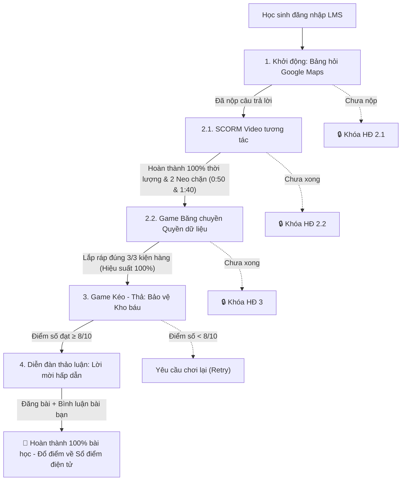

# HƯỚNG DẪN CHI TIẾT TRIỂN KHAI & CẤU HÌNH HỌC LIỆU SỐ BÀI 6 TRÊN LMS
**Dành cho:** Giáo viên Tin học 6 & Quản trị viên hệ thống LMS  
**Bài học:** Bài 6: Dữ liệu cá nhân là tài sản của mỗi con người (Chuyên đề AI - 60 phút)  

---

## MỤC LỤC
1. Kịch bản phân cảnh chi tiết (Storyboard) gói SCORM / H5P Video tương tác (HĐ 2.1)
2. Hướng dẫn thiết lập luồng điều kiện mở khóa tự động (Prerequisites / Completion Tracking)
3. Hướng dẫn cấu hình chi tiết trên từng hệ thống LMS (Canvas, Moodle, K12Online, Azota)
4. Ngân hàng câu nhận xét mẫu của Giáo viên trên Diễn đàn (Theo thang Rubric 10 điểm)
5. Hướng dẫn khai thác bảng phân tích học tập (LMS Learning Analytics Dashboard)

---

## PHẦN 1: KỊCH BẢN PHÂN CẢNH CHI TIẾT (STORYBOARD) CHO VIDEO SCORM / H5P

* **Tên tệp:** `Video_Dau_Chan_Ky_Thuat_So_Interactive.mp4` / H5P Content ID: `interactive-video-b6`
* **Thời lượng gốc:** 02 phút 00 giây
* **Định dạng âm thanh/hình ảnh:** Hoạt họa 2D sinh động (Motion Graphics), giọng đọc chuẩn phổ thông, truyền cảm, nhịp độ vừa phải cho học sinh lớp 6.

```
+-----------------------------------------------------------------------------------------------+
| TIMECODE     | PHÂN CẢNH HÌNH ẢNH (VISUAL)               | LỜI THOẠI (AUDIO / VOICE-OVER)      |
+-----------------------------------------------------------------------------------------------+
| 00:00 - 00:25| Cảnh một bạn học sinh lớp 6 đang cầm điện | "Mỗi ngày, các em lướt mạng xã hội,  |
|              | thoại: lướt video, thả tim hình ảnh, gõ   | thả tim một bức ảnh, xem một đoạn    |
|              | tìm kiếm tên một bài hát yêu thích.       | clip hài hước hay tìm kiếm lời giải  |
|              | Các biểu tượng like, tim, kính lúp bay    | bài tập... Em có nghĩ những hành động|
|              | lơ lửng và hóa thành những dấu vết phát   | này chỉ biến mất sau khi tắt máy?"   |
|              | sáng.                                     |                                      |
+-----------------------------------------------------------------------------------------------+
| 00:26 - 00:49| Cảnh bàn chân bước trên bãi cát để lại dấu| "Giống như bước chân đi trên cát ướt,|
|              | chân. Kế bên là màn hình máy tính với hàng| mỗi tương tác của em trên mạng đều để|
|              | loạt dấu chân kỹ thuật số màu xanh neon   | lại một dấu vết không bao giờ tự biến|
|              | gắn liền với tên tài khoản của bạn nhỏ.   | mất. Người ta gọi đó là gì nhỉ?"     |
+-----------------------------------------------------------------------------------------------+
| 00:50        | === [NEO CHẶN TƯƠNG TÁC 1: VIDEO DỪNG BẮT BUỘC TRẢ LỜI] =======================|
| (Pause)      | Popup trắc nghiệm hiện toàn màn hình:                                          |
|              | "Những lượt like, bình luận và video mà em đã xem được gọi là gì?"              |
|              | [ ] A. Dấu chân kỹ thuật số (Dữ liệu phản ánh hoạt động mạng) -> [ĐÚNG]        |
|              | [ ] B. Lịch sử duyệt web tạm thời, máy sẽ tự xóa                               |
|              | [ ] C. Tài sản công cộng của nhà mạng viễn thông                               |
|              | *Phản hồi khi đúng: Phát âm thanh Ting! và mở nút 'Xem tiếp'.                   |
|              | *Phản hồi khi sai: Rung nhẹ màn hình, yêu cầu chọn lại.                         |
+-----------------------------------------------------------------------------------------------+
| 00:51 - 01:15| Cảnh các biểu tượng dấu chân được gom lại | "Chính xác! Đó là 'Dấu chân kỹ thuật |
|              | vào một chiếc phễu thông minh khổng lồ của| số'. Theo pháp luật Việt Nam, đây    |
|              | máy tính máy chủ AI. Thuật toán AI phân   | chính là dữ liệu cá nhân của em.     |
|              | loại: thích đá bóng, thích anime, giờ ngủ| Các hệ thống máy tính âm thầm ghi lại|
|              | là 22h...                                 | để hiểu rõ thói quen của em hơn cả   |
|              |                                           | chính em đấy!"                       |
+-----------------------------------------------------------------------------------------------+
| 01:16 - 01:39| Màn hình hiển thị bảng phân tích và xuất  | "Nhưng các công ty công nghệ thu thập|
|              | hiện các biển quảng cáo đúng sở thích đập | dữ liệu này để làm gì? Họ có tặng    |
|              | vào mắt bạn học sinh: giày thể thao, khóa | quà miễn phí cho em không?"          |
|              | học vẽ hoạt hình... Kèm biểu tượng tiền tệ|                                      |
|              | tăng vọt.                                 |                                      |
+-----------------------------------------------------------------------------------------------+
| 01:40        | === [NEO CHẶN TƯƠNG TÁC 2: VIDEO DỪNG BẮT BUỘC TRẢ LỜI] =======================|
| (Pause)      | Popup trắc nghiệm hiện toàn màn hình:                                          |
|              | "Các công ty công nghệ thu thập dữ liệu hành vi của em chủ yếu để làm gì?"     |
|              | [ ] A. Để phân tích sở thích, gợi ý nội dung và quảng cáo kiếm tiền -> [ĐÚNG]   |
|              | [ ] B. Để tặng quà và tiền học bổng ngẫu nhiên cho học sinh                     |
|              | [ ] C. Để lưu trữ trong kho mà không bao giờ dùng đến                          |
+-----------------------------------------------------------------------------------------------+
| 01:41 - 02:00| Hình ảnh bạn nhỏ đeo huy hiệu 'Chủ nhân số'| "Dữ liệu cá nhân chính là tài sản vô |
|              | tự tin cầm chiếc khiên bảo vệ kho dữ liệu | giá của mỗi con người. Em chính là   |
|              | của mình. Xuất hiện dòng chữ: 'Em là chủ  | chủ nhân duy nhất có quyền quyết định|
|              | sở hữu - Hãy làm chủ dữ liệu của mình!'.  | cho ai xem, ai dùng. Hãy luôn là     |
|              |                                           | người sử dụng công nghệ thông thái!" |
+-----------------------------------------------------------------------------------------------+
```

---

## PHẦN 2: THIẾT LẬP LUỒNG ĐIỀU KIỆN MỞ KHÓA TỰ ĐỘNG (RESTRICT ACCESS / PREREQUISITES)

Để đảm bảo học sinh học tập nghiêm túc, đúng tiến trình sư phạm mà không nhảy cóc, GV thiết lập luồng **Hoàn thành hoạt động (Activity Completion)** trên LMS theo mô hình bậc thang:



---

## PHẦN 3: HƯỚNG DẪN CẤU HÌNH TRÊN TỪNG HỆ THỐNG LMS

### 1. Trên nền tảng Canvas LMS
1. **Tạo Module:** Đặt tên `[Bài 6] Dữ liệu cá nhân là tài sản của mỗi con người`.
2. **Thiết lập Prerequisites:**
   * Trong phần cài đặt Module, chọn `Requirements` $\rightarrow$ `Students must complete all of these requirements` $\rightarrow$ `Students must move through requirements in sequential order`.
3. **Cấu hình từng mục:**
   * **Mục 1 (Poll):** Tạo `Ungraded Survey` hoặc `Discussion`. Tiêu chí hoàn thành: `Submit the assignment`.
   * **Mục 2 (Video):** Tạo trang nhúng LTI H5P Interactive Video / SCORM. Tiêu chí: `Must view the item` hoặc `Score at least 100%`.
   * **Mục 3 (Module):** Tạo Canvas Page có bài tập Cloze. Tiêu chí: `Must mark as done` sau khi đạt điểm.
   * **Mục 4 (Game):** Tạo Assignment (External Tool). Tiêu chí: `Score at least 8 out of 10`.
   * **Mục 5 (Forum & Rubric):** Tạo Graded Discussion. Bật tính năng `Users must post before seeing replies`. Bấm vào menu 3 chấm $\rightarrow$ `Show Rubric` $\rightarrow$ Thêm bảng Rubric 10 điểm (3 tiêu chí) để dùng SpeedGrader chấm 1 chạm.

### 2. Trên nền tảng Moodle
1. **Bật Activity Completion:** Vào `Course Settings` $\rightarrow$ `Enable completion tracking` = **Yes**.
2. **Cấu hình HĐ 1:** Thêm hoạt động `Choice` (Khảo sát nhanh). Trong mục `Activity completion`, chọn: *Show activity as complete when user makes a choice*.
3. **Cấu hình HĐ 2.1:** Thêm hoạt động `H5P` hoặc `SCORM package`. Mục `Restrict access`: Thêm điều kiện *Hoạt động 1 phải completed*. Mục `Grade`: Passing grade = 10.
4. **Cấu hình HĐ 3 (Game):** Thêm H5P Drag and Drop. Mục `Grade to pass`: Điền **8.0**. Mục `Restrict access`: Yêu cầu hoàn thành HĐ 2.2.
5. **Cấu hình HĐ 4 (Diễn đàn):** Thêm `Forum`. Loại diễn đàn: `Standard forum for general use` hoặc `Q and A forum`. Trong mục `Ratings/Grading`: Chọn `Point` (Scale: 10). Gắn mẫu chấm `Rubric`.

### 3. Trên nền tảng K12Online / Azota
1. **Tạo Bài giảng chuyên đề:**
   * Thêm bài học mới dạng **Tiến trình bài học** (SCORM/E-learning).
   * Tải tệp SCORM/HTML mô phỏng (`LMS_Bai6_Interactive_Module.html`) lên thư viện học liệu số.
2. **Cài đặt chặn tua & tỷ lệ hoàn thành:**
   * Bật tùy chọn: `Không cho phép tua video / bài giảng`.
   * Tỷ lệ học tối thiểu: **100%**.
3. **Tạo Bài tập Diễn đàn & Rubric:**
   * Thiết lập bài tập tự luận mở với biểu mẫu chấm tiêu chí tương thích bảng Rubric 10 điểm của Bộ Giáo dục và Đào tạo.

---

## PHẦN 4: NGÂN HÀNG CÂU PHẢN HỒI MẪU CỦA GIÁO VIÊN TRÊN DIỄN ĐÀN
*(Tương thích công cụ SpeedGrader / Chấm nhận xét tự động theo Rubric)*

### Mẫu 1: Dành cho Học sinh đạt mức Tốt (8 - 10 Điểm)
> *"Thầy/Cô khen ngợi câu trả lời rất sắc sảo của em! Em đã thể hiện tư duy làm chủ công nghệ rất tốt khi dứt khoát từ chối cấp quyền danh bạ cho ứng dụng học Toán. Đặc biệt, em đã nắm rất vững kiến thức bài học khi chỉ ra quyền 'Rút lại sự đồng ý' và biết cách vào phần Cài đặt điện thoại để thu hồi quyền đã cấp. Tương tác với bạn bè cũng rất văn minh, lịch sự. Chúc mừng em đạt điểm tối đa!"*

### Mẫu 2: Dành cho Học sinh đạt mức Đạt (5 - 7 Điểm)
> *"Chào em, quyết định từ chối cấp quyền danh bạ của em là hoàn toàn chính xác vì ứng dụng học Toán không cần thông tin này. Tuy nhiên, ở vế thứ 2 (khi lỡ bấm Đồng ý), em cần bổ sung cách xử lý cụ thể hơn: Em có thể vào Cài đặt máy để Tắt quyền truy cập danh bạ (đây chính là Quyền rút lại sự đồng ý của chủ thể dữ liệu) hoặc gỡ bỏ ứng dụng. Em hãy đọc thêm gợi ý ở bài viết của bạn Trang để hoàn thiện nhé!"*

### Mẫu 3: Dành cho Học sinh đạt mức Cần cố gắng (< 5 Điểm)
> *"Chào em, việc đồng ý cấp toàn bộ danh bạ và định vị chỉ để nhận 30 ngày dùng thử VIP là quyết định tiềm ẩn rất nhiều rủi ro mất an toàn thông tin cho bản thân và người thân trong danh bạ. Danh bạ và vị trí là dữ liệu cá nhân nhạy cảm, em không nên chia sẻ tùy tiện khi ứng dụng không thực sự cần đến. Em hãy xem lại Video bài giảng ở Hoạt động 2 và viết lại câu trả lời để cải thiện điểm số nhé!"*

---

## PHẦN 5: BẢNG THEO DÕI NĂNG LỰC HỌC TẬP (LEARNING ANALYTICS DASHBOARD)

Dựa trên dữ liệu log hệ thống LMS tự động xuất ra, Giáo viên có thể nắm bắt ngay:

1. **Chỉ số Nhận thức quyền dữ liệu:** Tỷ lệ % học sinh chọn từ chối cấp quyền trong tình huống khởi động và tình huống vận dụng (chỉ số đo lường năng lực NLa: Tư duy lấy con người làm trung tâm).
2. **Tỷ lệ vượt ải Game Kéo thả lần đầu:** Nếu > 80% học sinh đạt $\ge 8/10$ ngay lượt 1 chứng tỏ học sinh phân biệt rất tốt giữa Dữ liệu cơ bản và Dữ liệu nhạy cảm.
3. **Chỉ số Tương tác cộng đồng số:** Số lượng lượt thích (tim) và số lượng phản hồi chéo trên Forum chứng minh phẩm chất trách nhiệm và năng lực giao tiếp hợp tác trong môi trường số.

