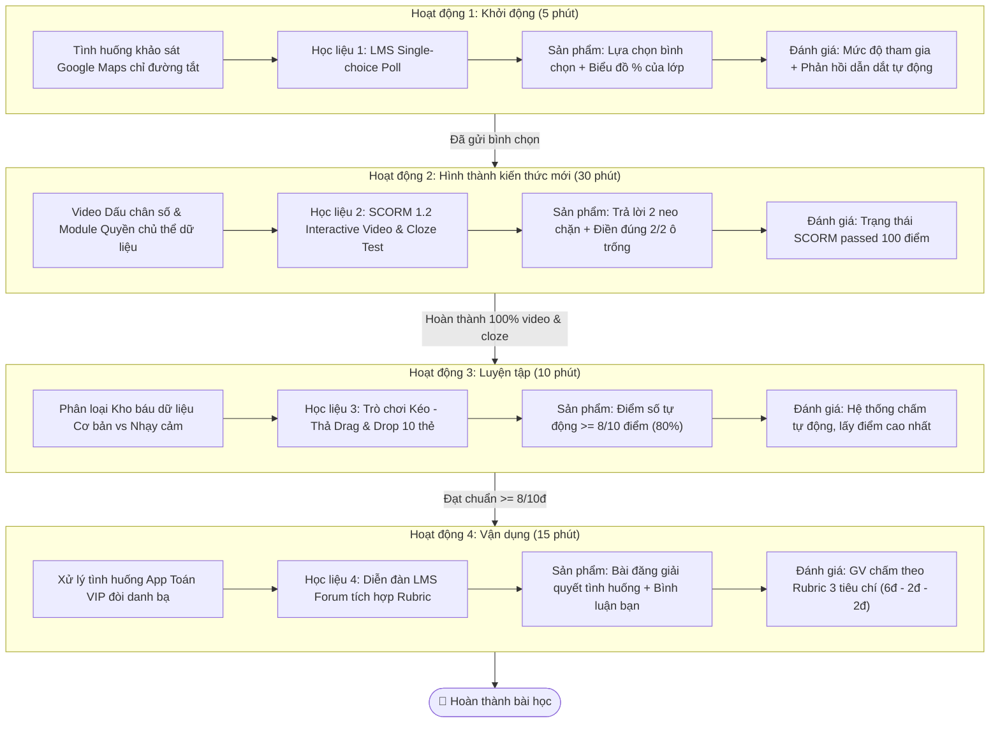

# PHẦN 2. THIẾT KẾ – PHÁT TRIỂN – TRIỂN KHAI BÀI HỌC THEO MÔ HÌNH ADDIE
### BÀI 6: DỮ LIỆU CÁ NHÂN LÀ TÀI SẢN CỦA MỖI CON NGƯỜI (MÔN TIN HỌC 6)
**HỌC PHẦN:** ĐÀO TẠO ĐIỆN TỬ VÀ ỨNG DỤNG (COMP1820)  
**CHUYÊN ĐỀ:** TRÍ TUỆ NHÂN TẠO (AI) — THỜI LƯỢNG: 01 TIẾT TRỰC TUYẾN TRÊN LMS (60 PHÚT)  

---

## 2.1. Giai đoạn Phân tích (Analysis)
* **Phân tích đối tượng người học**:
  - Học sinh lớp 6 (11–12 tuổi), sinh ra trong thời đại bùng nổ thiết bị thông minh, hàng ngày sử dụng các ứng dụng học tập, mạng xã hội, trò chơi trực tuyến.
  - *Đặc điểm tâm lý:* Hồn nhiên, tò mò, thích tương tác nhanh, thường có thói quen bấm "Cho phép" / "Đồng ý" mọi quyền ứng dụng đòi hỏi chỉ để nhanh chóng được chơi thử hoặc dùng ứng dụng VIP miễn phí mà không hề đọc điều khoản.
  - *Rào cản nhận thức:* Các em chưa hiểu được dữ liệu cá nhân (đặc biệt là danh bạ điện thoại, vị trí định vị GPS, khuôn mặt sinh trắc học) là **tài sản nhân thân vô giá**, nếu lộ lọt sẽ mang lại nguy cơ mất an toàn cho bản thân và gia đình.
* **Phân tích bối cảnh và điều kiện dạy học**:
  - Hình thức dạy học: E-learning 100% (Tiết học trực tuyến trên hệ thống quản lý học tập LMS).
  - Học sinh học tập độc lập tại nhà qua máy tính hoặc điện thoại có kết nối Internet $\rightarrow$ Bài học phải thiết kế tự động hóa khâu giao việc, có phản hồi sửa sai tức thì và cơ chế mở khóa tuần tự để giữ chân người học.

---

## 2.2. Giai đoạn Thiết kế (Design)

### Kịch bản sư phạm tổng thể (Ma trận liên kết 4 hoạt động theo Công văn 5512)

---

## 2.3. Giai đoạn Phát triển học liệu (Hồ sơ thẻ What – Why – How cho 4 học liệu)

### THẺ HỌC LIỆU 1: BẢNG HỎI KHẢO SÁT NHANH (HĐ KHỞI ĐỘNG)
* **WHAT (Học liệu là gì?):** Module khảo sát trực tuyến dạng chọn 1 đáp án (Single-choice Poll) tích hợp biểu đồ phân bố % thời gian thực và phản hồi sư phạm tự động.
* **WHY (Tại sao sử dụng?):** Kích hoạt tư duy phản biện của học sinh về việc có nên nghe theo máy tính 100% khi đi theo đường tắt vắng vẻ hay không, dẫn dắt vào bài học về việc con người làm chủ quyết định bảo vệ tài sản dữ liệu.
* **HOW (Cách thức triển khai):** Tệp `hoc_lieu_1_khao_sat.html` chuẩn HTML5, tự động đồng bộ kết quả bình chọn và mở khóa Hoạt động 2.

### THẺ HỌC LIỆU 2: GÓI SCORM VIDEO TƯƠNG TÁC & MODULE BÀI GIẢNG (HĐ HÌNH THÀNH KIẾN THỨC)
* **WHAT (Học liệu là gì?):** Video tương tác SCORM 1.2 tích hợp video thật `Dấu chân kỹ thuật số của bạn.mp4` (2 phút 34 giây) có 2 điểm neo chặn trắc nghiệm (0:50 và 1:40), kèm Module vi mô về quyền của chủ thể dữ liệu và bài tập điền khuyết tự động chấm.
* **WHY (Tại sao sử dụng?):** Đạt Yêu cầu cần đạt 6.A3.3, giải thích bản chất "dấu chân số" và các quyền pháp lý bất khả xâm phạm theo Điều 9 & Điều 20 Nghị định 13/2023/NĐ-CP và Hướng dẫn UNICEF 2021.
* **HOW (Cách thức triển khai):** Tệp `hoc_lieu_2_video_scorm.html` và gói đóng gói `SCORM_Bai6_HoatDong2_VideoTuongTac.zip` tích hợp `scorm_api.js`.

### THẺ HỌC LIỆU 3: GAME KÉO - THẢ "BẢO VỆ KHO BÁU DỮ LIỆU" (HĐ LUYỆN TẬP)
* **WHAT (Học liệu là gì?):** Trò chơi kéo thả Gamification 3.0 Pro phong cách Cyberpunk, âm thanh synth Web Audio, phân loại 10 thẻ dữ liệu vào 2 giỏ "Dữ liệu cá nhân cơ bản" và "Dữ liệu cá nhân nhạy cảm".
* **WHY (Tại sao sử dụng?):** Giúp học sinh nhận diện và phân loại chính xác các dữ liệu nhạy cảm dễ bị lộ lọt (GPS, bệnh án, FaceID, mật khẩu ngân hàng, lịch sử di chuyển).
* **HOW (Cách thức triển khai):** Tệp `hoc_lieu_3_gamification_keo_tha.html`, tính điểm tự động, yêu cầu đạt $\ge 8/10$ điểm mới cho phép qua bài, hỗ trợ cả chuột lẫn cảm ứng điện thoại.

### THẺ HỌC LIỆU 4: DIỄN ĐÀN THẢO LUẬN KÈM BẢNG RUBRIC 10 ĐIỂM (HĐ VẬN DỤNG)
* **WHAT (Học liệu là gì?):** Không gian mở Diễn đàn thảo luận (LMS Forum) kèm tình huống giả định "Lời mời hấp dẫn", tích hợp bộ kiểm tra tiêu chuẩn tự động (Checklist validator) và Bảng Rubric 10 điểm (3 tiêu chí) cho Giáo viên chấm điểm.
* **WHY (Tại sao sử dụng?):** Đánh giá năng lực ra quyết định từ chối cấp quyền dư thừa và năng lực khắc phục sai lầm bằng cách thực hiện quyền rút lại sự đồng ý theo Điều 9 Nghị định 13/2023/NĐ-CP.
* **HOW (Cách thức triển khai):** Tệp `hoc_lieu_4_dien_dan_rubric.html`, cài đặt chế độ "Đăng bài trước khi xem" và liên kết Sổ điểm điện tử LMS.

---

## 2.4. Giai đoạn Triển khai trên Hệ thống LMS (Implementation)
1. **Thiết lập chuỗi mở khóa tuần tự (Sequential Prerequisites):**
   * HĐ 1 hoàn thành $\rightarrow$ Mở khóa HĐ 2.
   * HĐ 2 xem đủ 100% video & điền đúng 2/2 ô trống $\rightarrow$ Mở khóa HĐ 3.
   * HĐ 3 đạt điểm số $\ge 8/10$ điểm $\rightarrow$ Mở khóa HĐ 4.
   * HĐ 4 đăng bài & tương tác bạn học $\rightarrow$ Hoàn tất 100% tiến trình học tập.
2. **Triển khai kỹ thuật:**
   * Tải tệp gói SCORM `SCORM_Bai6_HoatDong2_VideoTuongTac.zip` lên LMS hoặc sao chép mã nhúng Iframe từ cổng `index.html`.

---

## 2.5. Giai đoạn Đánh giá và Cải tiến (Evaluation)
* **Đánh giá thường xuyên (Formative Assessment):** Điểm số tự động tại 2 điểm neo chặn trong video, bài tập điền khuyết và trò chơi kéo thả.
* **Đánh giá tổng kết hoạt động (Summative Assessment):** Đánh giá định lượng năng lực giải quyết vấn đề và trách nhiệm số của học sinh qua Bảng Rubric 10 điểm trên Diễn đàn LMS.

