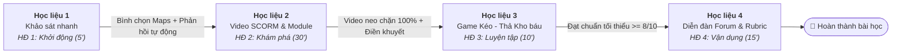

# Trọn Bộ Học Liệu Tin Học 6: Bài 6 - Dữ Liệu Cá Nhân Là Tài Sản Của Mỗi Con Người
> **Hình thức dạy học:** Dạy học trực tuyến 100% trên hệ thống quản lý học tập LMS (E-learning hoàn toàn - Thời lượng: 1 tiết 60 phút).  
> **Căn cứ thiết kế:** Kế hoạch bài dạy (KHBD) Tin học 6 Bài 6, Công văn số 5512/BGDĐT-GDTrH, Nghị định số 13/2023/NĐ-CP (Bảo vệ dữ liệu cá nhân), Hướng dẫn UNICEF (2021) Policy Guidance on AI for Children 2.0, Lý thuyết Học đa phương tiện (Clark & Mayer, 2011).

---

## 🌐 TỔNG QUAN 4 CỤM HỌC LIỆU SỐ TRÊN HỆ THỐNG LMS

Tiết học được thiết kế thành **Chuỗi học tập tuần tự có điều kiện (Conditional / Linear Learning Path)** bám sát 4 hoạt động của tiến trình dạy học:

---

### 1. `hoc_lieu_1_khao_sat.html` (Hoạt động 1: Khởi động - 5 phút)
* **Loại công cụ LMS:** Bảng hỏi khảo sát nhanh (Single-choice Poll / Survey).
* **Nhiệm vụ học sinh:** Đọc tình huống Google Maps gợi ý đường tắt qua bãi đất trống rậm rạp, chọn 1 trong 3 phương án và quan sát biểu đồ phân bố % của lớp.
* **Cơ chế sư phạm:** Tự động gửi thông điệp dẫn dắt của Giáo viên: *"Công nghệ tính toán rất nhanh nhưng con người mới là người đưa ra quyết định cuối cùng!"*, tự động mở khóa Hoạt động 2.

### 2. `hoc_lieu_2_video_scorm.html` (Hoạt động 2: Hình thành kiến thức - 30 phút)
* **Loại công cụ LMS:** Video tương tác SCORM 1.2 & **Game Dây chuyền sản xuất vi mạch (Conveyor Belt Factory Game)**.
* **Tệp video thực tế:** `Dấu chân kỹ thuật số của bạn.mp4` (Thời lượng 2 phút 34 giây).
* **Cơ chế neo chặn (Gatekeeping):** Khóa tính năng tua nhanh. Video tự động dừng tại:
  * **Neo chặn 1 (Giây 0:50):** Câu hỏi trắc nghiệm định nghĩa "Dấu chân kỹ thuật số" *(Điều 2 Khoản 3 mục k NĐ 13/2023/NĐ-CP)*.
  * **Neo chặn 2 (Giây 1:40):** Câu hỏi trắc nghiệm mục đích thu thập dữ liệu hành vi của các công ty công nghệ (phân tích sở thích & bán quảng cáo kiếm tiền).
* **Game Dây chuyền sản xuất vi mạch (Tab 2.2):** Băng chuyền chuyển động liên tục mang theo 3 kiện hàng. Học sinh kéo thả hoặc nhấp chọn các chip linh kiện vi mạch (`💎 Chủ sở hữu`, `🛑 Rút lại sự đồng ý`, `👨‍👩‍👧 Trẻ em & Cha mẹ / Người giám hộ`) lắp ráp vào kiện hàng. Tích hợp âm thanh Web Audio API synth, hiệu suất đạt 100% tự động mở khóa HĐ 3.

### 3. `hoc_lieu_3_gamification_keo_tha.html` (Hoạt động 3: Luyện tập - 10 phút)
* **Loại công cụ LMS:** Bài tập trò chơi hóa (Gamification 3.0 Pro) Kéo - Thả chuẩn HTML5 (Âm thanh synth Web Audio, hỗ trợ cả chuột và cảm ứng điện thoại).
* **Nhiệm vụ học sinh:** Phân loại 10 thẻ dữ liệu vào 2 giỏ kho báu: **Dữ liệu cá nhân cơ bản** và **Dữ liệu cá nhân nhạy cảm** theo Điều 2 Nghị định 13/2023/NĐ-CP.
* **Tiêu chuẩn vượt qua (Grade to Pass):** Đạt tối thiểu **8/10 điểm (80%)**. Tự động đồng bộ điểm số vào Sổ điểm điện tử LMS qua `scorm_api.js`.

### 4. `hoc_lieu_4_dien_dan_rubric.html` (Hoạt động 4: Vận dụng - 15 phút)
* **Loại công cụ LMS:** Diễn đàn thảo luận (Forum) tích hợp Rubric chấm điểm định lượng 10 điểm (Whole Forum Grading).
* **Chủ đề thảo luận:** Tình huống giả định *"Lời mời hấp dẫn"* từ ứng dụng giải Toán bằng AI đòi quyền danh bạ và GPS.
* **Nhiệm vụ học sinh:** Đưa ra quyết định từ chối, nêu thao tác thu hồi quyền truy cập (rút lại sự đồng ý) và tương tác với ít nhất 1 bạn trong lớp.
* **Ma trận Rubric 3 tiêu chí:**
  1. *Khả năng giải quyết tình huống:* 6.0 điểm
  2. *Lập luận dựa trên kiến thức pháp lý:* 2.0 điểm
  3. *Kỹ năng tương tác và Trách nhiệm số:* 2.0 điểm

---

## 📑 HỒ SƠ TÀI LIỆU VÀ CÔNG CỤ ĐỒNG HÀNH TRONG THƯ MỤC

1. **`index.html`**: Cổng trải nghiệm trung tâm (Virtual LMS Portal) với thiết kế hiện đại, responsive, Live Iframe Player và bộ mã nhúng.
2. **`SCORM_Bai6_HoatDong2_VideoTuongTac.zip`**: Gói nén SCORM 1.2 chuẩn ADL sẵn sàng tải lên Moodle, Canvas, K12Online.
3. **`sach_hoc_sinh_va_phieu_hoc_tap.html`**: Bản in Sách học sinh khổ A4 có thanh công cụ in ấn (Print to PDF).
4. **`rubric_pdf_template.html`**: Bản in Bảng kiểm Rubric 10 điểm định lượng chuẩn Công văn 5512/BGDĐT.
5. **`BAO_CAO_A3.4_THIET_KE_PHAT_TRIEN_BAI_HOC_LMS.md`**: Báo cáo học thuật toàn diện theo 5 giai đoạn mô hình ADDIE.
6. **`MUC_3.2_CAC_HOAT_DONG_HOC_KHBD_BAI_6.md`**: Tiến trình chi tiết 4 hoạt động học chuẩn Công văn 5512/BGDĐT-GDTrH.
7. **`HOC_LIEU_SO_LMS_BAI_6.md`**: Hồ sơ đặc tả kỹ thuật chi tiết 5 học liệu số.
8. **`HUONG_DAN_TRIEN_KHAI_LMS.md`**: Hướng dẫn giáo viên cấu hình chi tiết trên Moodle, Canvas, K12Online, Azota và ngân hàng câu nhận xét mẫu.
9. **`scorm_api.js`**: Adapter chuẩn kết nối SCORM 1.2 an toàn, chống lỗi Cross-Origin.

---

## 🚀 HƯỚNG DẪN MỞ VÀ TRẢI NGHIỆM TRỰC TIẾP
* **Cách 1 (Toàn cảnh):** Nhấp đúp chuột mở tệp **`index.html`** bằng trình duyệt bất kỳ (Chrome, Edge, Cốc Cốc) để trải nghiệm toàn bộ cổng học liệu.
* **Cách 2 (Từng học liệu):** Nhấp đúp vào từng tệp `hoc_lieu_1_khao_sat.html`, `hoc_lieu_2_video_scorm.html`, `hoc_lieu_3_gamification_keo_tha.html`, `hoc_lieu_4_dien_dan_rubric.html`.
* **Cách 3 (Nhúng LMS):** Tải gói **`SCORM_Bai6_HoatDong2_VideoTuongTac.zip`** lên mục SCORM của Moodle / Canvas hoặc sao chép mã Iframe trong `index.html`.

